.. raw:: html

    <embed>
       
    </embed>

.. |LFOM| image:: https://cad.onshape.com/api/thumbnails/d/49035a16b895fd8095d17a02/w/b76e9410efc3d9f5861e9516/s/300x170
  :width: 100
  :target: https://cad.onshape.com/documents/49035a16b895fd8095d17a02/w/b76e9410efc3d9f5861e9516/e/c063acb14de8f1f558b02d2d?configuration=HL_min%3D0.2%2Bmeter%3BND_max%3D12.0%3BQm_max%3D5.0%3BTEMP_min%3D10.0%3BdrillD_max%3D0.1%2Bmeter%3BprintParams%3Dfalse&renderMode=0&uiState=626fea458d39dd1e3b6106e1

.. |Doser| image:: https://cad.onshape.com/api/thumbnails/d/e71bb0c05d9e7241822776b7/w/533d9612b07de271291829dc/s/300x170
  :width: 100
  :target: https://cad.onshape.com/documents/e71bb0c05d9e7241822776b7/w/533d9612b07de271291829dc/e/20f111b627e4c6d59c3f0ff9?configuration=HL_max%3D0.2%2Bmeter%3BQ_pi%3D1.0%3BchlorineC_pi%3D0.6%3BcoagC_pi%3D0.5%3BprintParams%3Dfalse%3Brep%3Dtrue%3BtankOW%3D1.0%2Bmeter&renderMode=0&uiState=6273e0ecd685467dff5c17c4

.. |EntranceTank| image:: https://cad.onshape.com/api/thumbnails/d/4c47a124da3abec33e0ce813/w/3955cd0d266daedd3eabf165/s/300x170
  :width: 100
  :target: https://cad.onshape.com/documents/4c47a124da3abec33e0ce813/w/3955cd0d266daedd3eabf165/e/bcf152c5be02d9ab5b2b5285?configuration=L%3D8.0%2Bmeter%3BQm_max%3D40.0%3BShow_Internal_Components%3Dtrue%3BTEMP_min%3D10.0%3BcaptureVm%3D20.0%3BflocUpstreamHW%3D2.0%2Bmeter%3BprintParams%3Dfalse%3Brep%3Dtrue&renderMode=0&uiState=626fea87ee1eae4ff2291321

.. |FlocculatorVH| image:: https://cad.onshape.com/api/thumbnails/d/673077f4fa843a817d4cd55d/w/8bd189f4769c2a64aa07a8c0/s/300x170
  :width: 100
  :target: https://cad.onshape.com/documents/673077f4fa843a817d4cd55d/w/8bd189f4769c2a64aa07a8c0/e/cdc0c6cfa0e8b64f179ced51?configuration=GT_min%3D35000.0%3BG_bod%3D50.0%3BQm_max%3D1.0%3BShow_Internal_Components%3Dtrue%3BTEMP_min%3D5.0%3BoutletHW%3D1.7%2Bmeter%3BprintParams%3Dfalse%3Brep%3Dtrue&renderMode=0&uiState=626feb5ffb767608344ad1ad

.. |FlocculatorHV| image:: https://cad.onshape.com/api/thumbnails/d/9742e8c019b742df4ae4db85/w/cbe4d0f58d318c45281687ae/s/300x170
  :width: 100
  :target: https://cad.onshape.com/documents/9742e8c019b742df4ae4db85/w/cbe4d0f58d318c45281687ae/e/05162587e7127122572d3a10?configuration=GT_min%3D35000.0%3BG_bod%3D50.0%3BL%3D6.0%2Bmeter%3BQm_max%3D30.0%3BShow_Internal_Components%3Dtrue%3BTEMP_min%3D25.0%3BoutletHW%3D2.0%2Bmeter%3BprintParams%3Dfalse%3Brep%3Dtrue&renderMode=0&uiState=626feb168bd195153bbbe9af

.. |FlocculatorHH| image:: https://cad.onshape.com/api/thumbnails/d/84c4c94f9773b67506cd35bb/w/58a1f53fe5ebbbbc808a3541/s/300x170
  :width: 100
  :target: https://cad.onshape.com/documents/84c4c94f9773b67506cd35bb/w/58a1f53fe5ebbbbc808a3541/e/aa5906755ba02b0a3925ec10?configuration=GT_min%3D35000.0%3BG_bod%3D50.0%3BQm_max%3D200.0%3BShow_Internal_Components%3Dtrue%3BTEMP_min%3D0.0%3BoutletHW%3D3.0%2Bmeter%3BprintParams%3Dfalse%3Brep%3Dtrue&renderMode=0&uiState=626fead687c54745ef4c039f

.. |Clarifier| image:: https://cad.onshape.com/api/thumbnails/d/e05915c533ee7568c402981a/w/56de4202f426e6443151ca07/s/300x170
  :width: 100
  :target: https://cad.onshape.com/documents/e05915c533ee7568c402981a/w/56de4202f426e6443151ca07/e/3f94eabd115787bc33ae755d?configuration=G_max%3D140.0%3BQm_max%3D20.0%3BShow_Internal_Components%3Dtrue%3BTEMP_min%3D10.0%3BcaptureVm%3D0.12%3BprintParams%3Dfalse%3Brep%3Dtrue%3BrepBayInternals%3Dfalse%3BupVm%3D1.0&renderMode=0&uiState=627688ef04309300574a09f6

.. |OStaRS| image:: https://cad.onshape.com/api/thumbnails/d/8a1a990f01575e6e5eed1922/w/3811cfb89da77b076395fdc0/s/300x170
  :width: 100
  :target: https://cad.onshape.com/documents/8a1a990f01575e6e5eed1922/w/3811cfb89da77b076395fdc0/e/fd576f076cd3757b426c7f20?configuration=Qm_max%3D20.0%3BShow_Internal_Components%3Dtrue%3BTEMP_min%3D10.0%3BfilterHL_pi%3D0.5%3BfilterMode%3Dfalse%3BprintParams%3Dfalse%3Brep%3Dtrue%3BrepBayInternals%3Dfalse%3BrepInternalPiping%3Dfalse%3BspareFilter%3Dfalse&renderMode=0&uiState=6276885764a43e34bd8c13b9

.. |20-80Lpsplant| image:: https://cad.onshape.com/api/thumbnails/d/0e9ede93e11e5a54f68f8606/w/2744164cc6e56e3693a3190f/s/300x170
  :width: 100
  :target: https://cad.onshape.com/documents/0e9ede93e11e5a54f68f8606/w/2744164cc6e56e3693a3190f/e/723e9e9d93f3008c9815e2d6?configuration=Qm_max%3D40.0%3BShow_Internal_Components%3Dfalse%3BTEMP_min%3D10.0%3BprintParams%3Dfalse%3Brep%3Dfalse&renderMode=0&uiState=626fedaca473381cd632eede

.. |ACRlogowithname| image:: ../Images/ACRlogowithname.png
  :target: https://www.aguaclarareach.org/
  :height: 50

.. _title_AguaClara_PF_Specifications:

**************************************
Specifications for AguaClara PF Series
**************************************

.. check that all numrefs are pointing to the correct thing
.. change where the links to onshape lead. see bottom of this document for those.

This document describes the standard design, performance, materials, and operating features of AguaClara prefabricated (PF) Series drinking water treatment plants. AguaClara fabricates and supplies PF plants as integrated treatment systems. Unless a feature is identified as optional or project-specific, the features described here are included in the supplied plant. Plant dimensions and certain components are configured for the project design flow, source-water quality, site conditions, and applicable regulatory requirements. The PF plant is designed to produce safe, potable drinking water from source water that may be contaminated with particles, pathogens, and dissolved organics.

PF Series Application and Design Basis
======================================

AguaClara drinking water treatment technologies remove turbidity and pathogens from raw water and deactivate remaining pathogens before distribution. AguaClara technologies are best suited for centralized water treatment in communities of at least 200 people. AguaClara technologies are not intended to treat low-turbidity groundwater where the primary contaminants are chemicals such as nitrate, fluoride, or heavy metals. AguaClara technologies are gravity-driven and do not require electricity. When required by the topography, pumps can raise the source water to the elevation necessary for water treatment and water distribution.

AguaClara treatment technologies include trash and grit removal, flow measurement, chemical dosing, rapid mix, flocculation, floc filter, sedimentation, filtration, and disinfection. The :ref:`floc filter <title_Clarification_Intro>` is a fluidized suspension of flocs located in the bottom of the clarifier. A PF plant can be configured with all of these processes. For source water with turbidity consistently below approximately 3 NTU, a project-specific configuration can omit flocculation, the floc filter, and sedimentation.

Water Quality Parameters
------------------------

The table below summarizes the raw water quality parameters for which AguaClara treatment technologies are appropriate.

.. _table_PF_Water_Quality_Parameters:

.. csv-table:: Water Quality Parameters Treated by AguaClara Plants
   :header: "Water Quality Parameter", "Comments"
   :align: left

   Turbidity, "PF plants are designed to consistently treat raw water with turbidity below 600 NTU to a turbidity below 1 NTU. Treatment of higher turbidities requires a customized clarifier design."
   "Color/Dissolved Organic Matter (DOM)", "For raw water with high color or total organic matter content, pilot studies are recommended to confirm the efficacy of the coagulant and the ability of the flocs to settle."
   pH, "pH can be lowered to prevent calcium carbonate scaling in distribution piping or increased to reduce corrosion potential."
   Microbiological contamination, "The AguaClara treatment processes are designed to remove pathogens through particle removal and deactivate pathogens through disinfection."

AguaClara plants are designed to treat the water quality parameters listed above. Removal of other contaminants requires verification by jar and/or pilot-scale testing. All other parameters need to be within acceptable ranges in the raw water or treated by other means.

Coagulant selection and plant configuration require bench-scale jar testing to confirm that polyaluminum chloride, aluminum sulfate, or another proposed coagulant successfully forms settleable flocs.

Entrance Tank
==============

For more detailed information, see :ref:`Entrance Tank Design <title_entrance_tank_design>`. The entrance tank (see :numref:`figure_spec_PF_ET_Diagram_Labeled`) has multiple functions in a drinking water treatment plant.

#. Remove air bubbles to reduce splashing, turbulence, and unsteady motion of the chemical feed surface tracking lever system
#. Remove grit to prevent accumulation in the flocculator
#. Remove leaves and other debris to prevent clogging of the diffusers in the clarifier inlet
#. Dissipate kinetic energy to keep the water level steady for accurate flow measurement
#. Measure the incoming flow rate with the Linear Flow Orifice Meter (LFOM) so that operators can make adjustments and respond to changes in water demand
#. Inject the coagulant and any other amendments required for flocculation

.. _figure_spec_PF_ET_Diagram_Labeled:

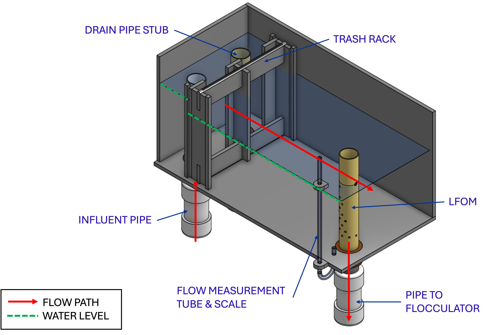

    Cross-section of an entrance tank. Chemical dosing system not shown.

Grit Removal
------------

A. The entrance tank is designed as a horizontal-flow sedimentation tank for grit removal with a capture velocity below 15 mm/s.

#. The bottom of the entrance tank can easily be cleaned by temporarily removing the pipe stub that blocks the drain.

Trash Rack
----------

A. The trash rack openings are smaller than the diffusers in the clarifier and the orifices in the stacked rapid sand filter inlet branches.

#. The trash rack area accommodates at least 80% clogging without exceeding the available head loss in the entrance tank.

Linear Flow Orifice Meter (LFOM) or Equivalent |LFOM|
-----------------------------------------------------

A. The plant entrance tank is equipped with a flow-measurement device designed to produce a linear relationship between plant flow and the water level in the entrance chamber. The standard device is the Linear Flow Orifice Meter (LFOM), which has a pattern of orifices through which flow exits the entrance tank. A demonstrated equivalent, such as a Sutro weir, can be substituted in a project-specific configuration.

#. The orifice pattern is designed so that the water level in the entrance chamber (equal to the hydrostatic head pushing water through the orifices) is linearly proportional to the total flow through the orifices (equal to the plant flow). An example of an LFOM is shown in :numref:`figure_spec_PF_LFOM`. Depending on the configuration, the orifices are drilled in a flat plate or in the walls of a vertical pipe.

#. The LFOM measures flows from at least 25 percent to 100 percent of the maximum plant design flow. Project-specific configurations can extend the measurement range to lower flow rates.

#. To provide adequate flow-measurement resolution, the water level changes by at least 20 cm from no flow to the design flow rate.

.. _figure_spec_PF_LFOM:

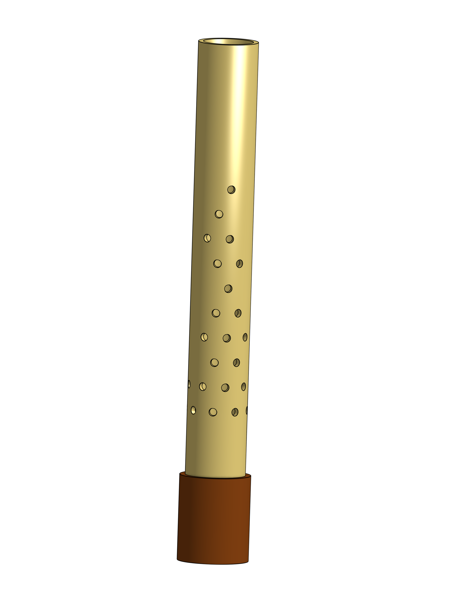

    Example of a Linear Flow Orifice Meter.

Chemical Dosing System
======================

For more detailed information, see :ref:`Linear chemical dosing system <heading_linear_cdc>`.

Capabilities and Design Features
--------------------------------

A. The system is capable of dosing chemicals for the following purposes. All wetted materials are compatible with the chemicals being dosed.

   1. Disinfectant (normally sodium or calcium hypochlorite)

   #. Coagulant (typically polyaluminum chloride [PACl]). Use of another coagulant, such as alum, requires justification and bench-scale jar testing confirming that the proposed coagulant successfully forms flocs.

   #. pH adjustment (if necessary)

#. The chemical dosing system operates by gravity and does not depend on pumps or electrical power.

#. Chemical dosing is flow-paced: the rate of chemical application automatically adjusts in proportion to the flow rate of water moving through the plant.

#. The system is designed for easy disassembly and cleaning by the plant operator, including cleaning with vinegar to remove calcium carbonate deposits.

#. The plant operator adjusts the chemical dose (mass of chemical per volume of water passing through the plant) using the dose slider.

Chemical Storage
----------------

A. The plant includes at least two storage tanks for each chemical. Tank and fitting materials are compatible with the stored chemical. Compatible plastic storage tanks can be used.

#. The combined storage volume for each chemical supplies the plant at maximum flow and maximum chemical dose for at least 48 hours.

Chemical Feed System
--------------------

The plant is equipped with a chemical feed system configured as shown in :numref:`figure_spec_PF_chemDoseController`. Materials that contact chemicals are compatible with each chemical and suitable for use with potable water.

.. _figure_spec_PF_chemDoseController:

.. figure:: ../Images/CDC_derivation.png
    :width: 500px
    :align: center
    :alt: chemDoseController

    Gravity-powered chemical feed system schematic.

A. Constant Level Tank

   1. From the chemical storage tanks, the chemical passes via gravity to a constant level tank (see :numref:`figure_spec_PF_constantLevelTank`). The chemical enters the constant level tank via a float valve, which maintains a constant level of chemical, providing a constant head to drive the chemical through the doser.

   #. The chemical level in the constant level tank is at the same elevation as the hanging weir when the slider is at the minimum position of the dosing lever.

.. _figure_spec_PF_constantLevelTank:

.. figure:: ../Images/CLT.png
    :width: 600px
    :align: center
    :alt: Constant Level Tank

    Constant level tank module for coagulant and chlorine.

B. Dosing Tubes

   1. Chemical flows from the constant level tank through resistors and then through tubes that terminate in a free discharge at the dose slider on the doser balance.

   #. The resistors are sized to provide laminar flow over the desired range of chemical flow rates. Under laminar-flow conditions, the flow rate through the resistors is directly proportional to the elevation difference between the chemical level in the constant level tank and the dose slider.

   #. The plant includes a spare set of resistors for each chemical feed so that one set of tubes can be cleaned while the other set is in use.

   #. Head loss through all other tubes and fittings connecting the constant level tank to the free discharge at the dose slider is less than 5% of the head loss through the resistors.

#. Chemical Dose Controller |Doser|

   1. One end of the chemical doser balance (see :numref:`figure_spec_PF_doser`) is connected to a float in the plant entrance tank. The dose slider and the ends of the doser hoses are located on the other end of the chemical doser balance.

.. _figure_spec_PF_doser:

.. figure:: ../Images/doser.png
    :width: 500px
    :align: center
    :alt: Doser

    Chemical dose controller designed for two independent chemical feeds.

D. Function

   1. The doser balance is designed so that the operator can select a chemical dose (mass of chemical per volume of water) by moving the dose slider to a specific position along the lever. The lever, LFOM, and constant level tank then work together to adjust the chemical flow in proportion to the plant flow to maintain a constant chemical dose.

   #. When the plant flow is zero, the lever is horizontal and chemical flow is zero.

   #. When plant flow increases, the water level in the entrance tank increases (due to additional head loss through the LFOM), causing one end of the doser balance to rise. This, in turn, causes the other end of the balance, and the dose slider, to fall, increasing the elevation difference between the chemical level in the constant level tank and the dose slider. The greater driving head increases the chemical flow through the doser.

   #. The water level in the entrance tank is directly proportional to the plant flow rate (due to the LFOM). The dose slider elevation is directly proportional to the entrance tank water level. The chemical flow is directly proportional to the dose slider elevation. Therefore, the chemical flow is directly proportional to the plant flow, and changes in the slider position directly set the chemical dose.

Flocculator
===========

For more detailed information, see :ref:`Flocculation Design <title_Flocculation_Design>`.

Design Basis
------------

The AguaClara flocculator is designed to:

A. Provide a head loss of 5 cm to provide gentle mixing and a residence time of approximately 1200 seconds (20 minutes), allowing aggregation of individual particles and small flocs into flocs large enough to settle out in the clarifier. This results in a velocity gradient of approximately 15 :math:`\mathrm{s}^{-1}`.

#. Facilitate manual sludge draining and maintenance by one person.

Flow Paths
----------

A. The flow passages are designed to be as close to square as possible given the constraints of the circular geometry and fabrication.

#. The upstream water depth of the flocculator is determined by the depth required by the filter and is approximately 115 cm.

#. The spacing between baffles is designed to achieve the target head loss at the design flow rate.

#. The ports between flocculator channels (see :numref:`figure_PFflocChannelPort`) have the same flow area as the space between the baffles so that each port improves flocculation without breaking flocs.

.. _figure_PFflocChannelPort:

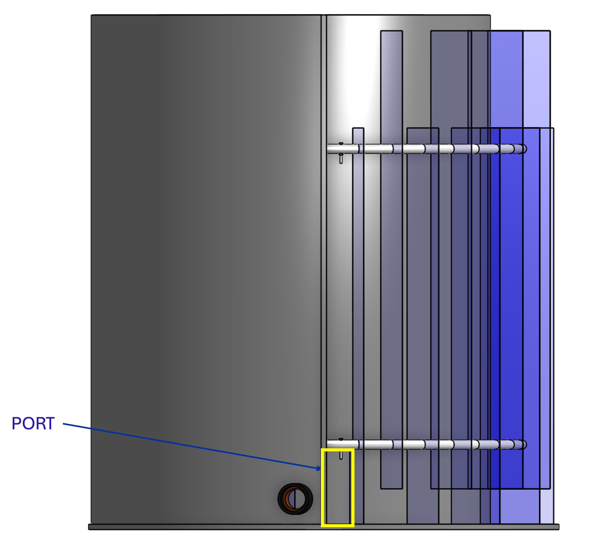

  Flocculator with side walls removed to show the port between channels. Water flows between flocculator channels through a port that has the same flow dimensions as the space between baffles.

Channel Construction
--------------------

A. The walls of the flocculation channels are vertical and maintain the channel width along both the length and height of each flocculator channel.

#. The drain pipe is activated via a valve and is sized to empty the flocculator in less than 20 minutes.

#. Operation requires sufficient ambient lighting for the operator to observe floc formation. Operators need a flashlight to observe floc formation during power outages.

Baffles
-------

A. The flocculation baffles are removable. One operator working alone can raise a baffle module (see :numref:`figure_spec_PFbaffleModule`) so that water flows beneath the baffle and drains from the flocculator channel. Large flocculator configurations can have baffle modules that require more than one person for complete removal.

#. The flocculation baffles are constructed from stainless steel or polycarbonate sheets. The baffle-module frames are constructed from PVC and PEX pipe.

.. _figure_spec_PFbaffleModule:

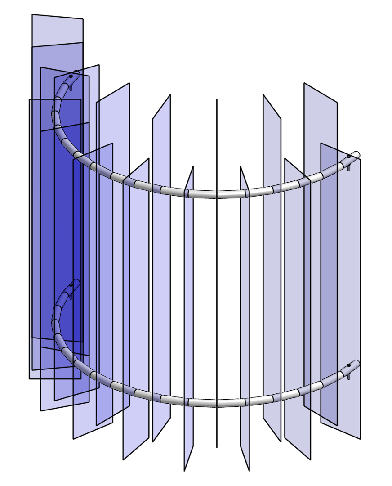

  The baffle modules transfer the force of the water to the downstream wall through the PVC and PEX pipe frame. Each flocculator channel holds one baffle module.

Clarifier
==========

For more detailed information, see :ref:`Clarifier Design <title_Clarifier_Design>`. The clarifier (see :numref:`figure_spec_PFclarifierElevation`) contains three separate processes: filtration in the floc filter, sedimentation in the plate settlers, and consolidation in the floc hopper. Flocculated water flows to the inlet manifold and then through the diffusers, jet reverser, floc filter, and plate settlers. Clarified water flows into the outlet manifold and out of the clarifier to the filter.

The clarifier configuration is based on the coldest design water temperature and the lowest-density primary particles to be captured. Surface waters with high concentrations of dissolved organic matter and low concentrations of suspended solids produce low-density flocs; for these source waters, the design uses a lower velocity gradient in the inlet manifold and jet reverser. Some source-water conditions require a larger clarifier plan-view area to reduce the floc filter upflow velocity and plate settler capture velocity.

.. _figure_spec_PFclarifierElevation:

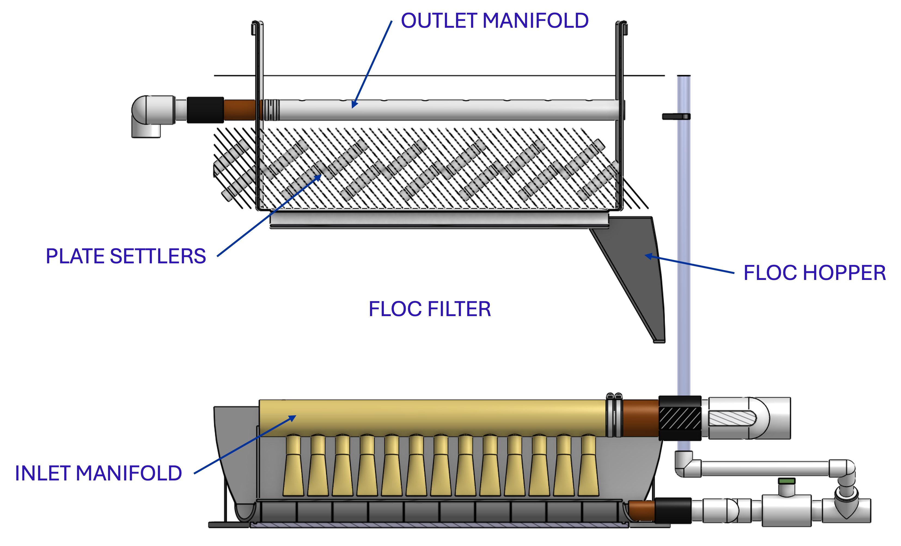

  Elevation view of the clarifier with no wall, showing location of the floc filter, plate settlers, and floc hopper.

The clarifier can be configured with multiple bays (see :numref:`figure_PF_clarifier_internals`) that work in parallel to treat the design flow.

.. _figure_PF_clarifier_internals:

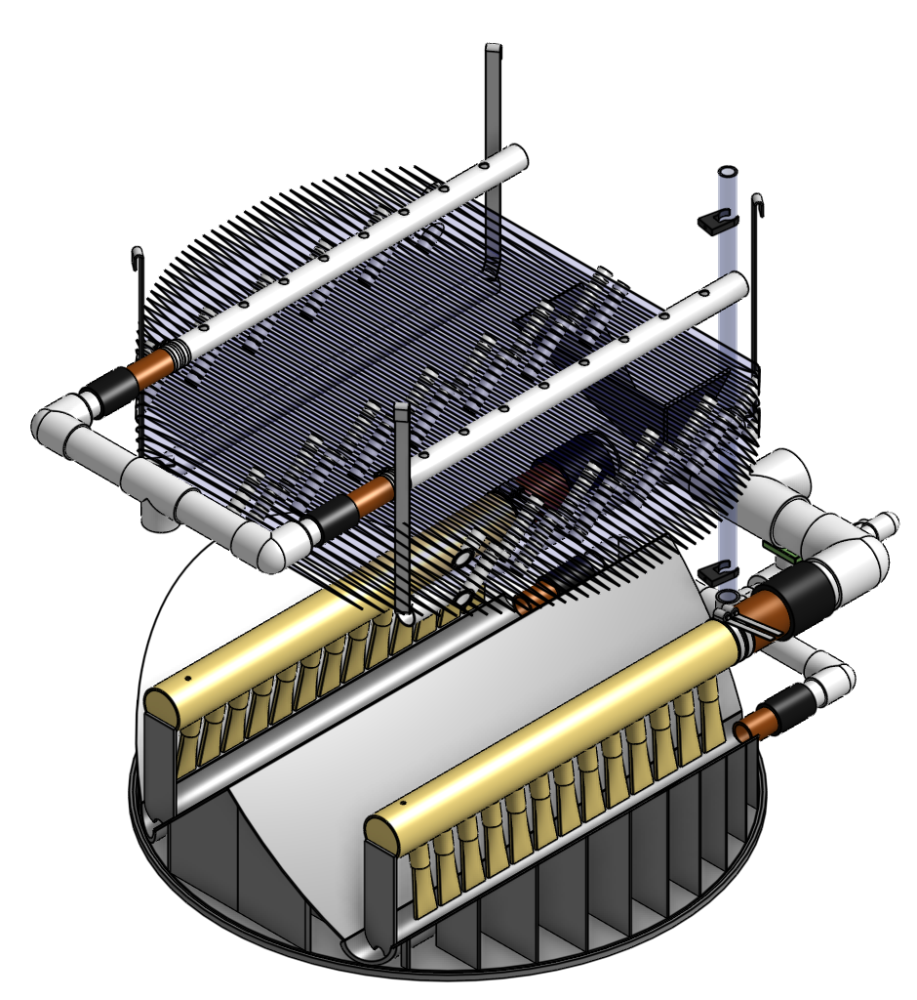

  Clarifier with two bays.

Design Basis
------------

The high-rate, vertical-flow clarifier is designed to:

A. To deliver flocs to the clarifier bay without breaking them into pieces with terminal velocities below the capture velocity of the plate settlers. This sets the maximum velocity gradient for the transfer of the flocs from the flocculator to the floc filter in the clarifier bay. The design limits the maximum velocity gradient to less than 360 :math:`\mathrm{s}^{-1}`. Lower design values are used for raw waters with high concentrations of dissolved organic matter.

#. To provide a mechanism for the operator to dump poorly flocculated water before it enters the clarifier. This is important to reduce the recovery time when there is a flocculation failure.

#. To produce a stable floc filter (fluidized suspension of flocs) that reduces the clarified water turbidity.

#. To provide evenly distributed low-velocity flow through the plate settlers.

#. To prevent accumulation of sludge that would tend to become anaerobic and release both dissolved organics (taste and odor issues) and methane bubbles that would carry flocs to the top of the clarifier.

#. To remove the solids without requiring power or moving mechanical parts.

#. To ensure easy operation and maintenance.

Inlet Manifold
--------------

Flocculated water enters the inlet manifold and then exits through a series of diffusers in the bottom of the pipe. The end of the inlet manifold is capped. The minimum diameter of the inlet manifold is set by the velocity gradient downstream of the 90-degree elbow (see Equation :eq:`D_pipe_min_of_K_and_jet_G_max`).

Diffusers
---------

The diffusers point down to the bottom of the clarifier bay and extend along the length of the pipe at regular intervals to ensure that water is evenly distributed within the bay. Diffusers are designed to ensure that the jet exiting the jet reverser has a maximum velocity gradient that is less than the design constraint to prevent excessive floc breakup (see Equation :eq:`planejet_v_max_of_q`).

Diffusers are shaped so that one end is molded to a reduced diameter that fits into the inlet manifold port, and the other end is deformed to the shape of a rectangle (:numref:`figure_spec_PF_diffuser_dimensions`). This deformation is done to create a line jet entering the jet reverser in the bottom of the clarifier bay and to enhance flow distribution by maximizing the jet velocity given the constraints of Equation :eq:`planejet_v_max_of_q`.

.. _figure_spec_PF_diffuser_dimensions:

.. figure:: ../Images/diffuser_dimensions.png
   :width: 500px
   :align: center
   :alt: Diffuser dimension definition

   Dimensions and geometry of a diffuser. The image on the left shows a view of a diffuser from the end of a clarifier bay. The image on the right shows a view of a diffuser from the side of a clarifier bay.

Jet Reverser
------------

The jet reverser consists of a longitudinally cut half-pipe that is laid in the bottom of the bay (see :numref:`figure_spec_PF_clarifierEndView`). It keeps flocs suspended in the clarifier by ensuring that the force of the diffuser jet propels settled flocs back upward.

The diffusers are offset from the jet reverser centerline. This is intentionally done to promote the resuspension of flocs, which form a floc filter for primary filtration.

.. _figure_spec_PF_clarifierEndView:

.. figure:: ../Images/clarifierEndView.png
   :width: 500px
   :align: center
   :alt: Clarifier showing jet reverser

   End view of a clarifier bay showing the sloped bottom, inlet manifold, diffusers, and jet reverser. The diffusers direct a jet of water into one side of the jet reverser.

Floc Filter
-----------

Floc filters significantly improve the performance of a clarifier and reduce the clarified water turbidity.

A. The line jet from the diffusers enters the jet reverser to force flow up through the clarifier bay. The vertical upward jet momentum is used to resuspend flocs that have settled to the bottom of the clarifier bay. The resuspended flocs form a fluidized bed, which is a floc filter. Small particles are captured by the flocs in the floc filter as the small particles flow through the flocs. The bed is fluidized because flocs are kept in suspension by the upflowing water.

#. Clarifiers use an upflow velocity of 1 mm/s in the floc filter. This velocity is measured above the sloped bottom in the section of the clarifier bay with vertical walls.

#. For a floc filter to form, a clarifier requires that:

   1. The plate settlers capture small flocs and cause them to aggregate into larger flocs as they avalanche back into the floc filter zone. The increased terminal velocity of the larger flocs enables them to create a stable floc filter.

   #. All settled flocs are resuspended by the vertical jet of water exiting the jet reverser.

Sloped Bottom Geometry
----------------------

The clarifier bottom geometry (see :numref:`figure_spec_PF_clarifierEndView`) prevents sludge accumulation while also ensuring good flow distribution. The slope on either side of the diffusers is at a 60-degree angle above horizontal. The bottom geometry allows for smooth flow expansion to the entire plan-view area of the bay and ensures that all flocs that settle are transported to the jet reverser. The diffusers do not touch the bottom of the tank so that flocs on both sides of the diffuser can return to the jet reverser for resuspension. Thus, there is no accumulation of settled flocs in the main clarifier bays.

Floc Hopper
-----------

The floc hopper (:numref:`figure_spec_PFflocHopper`) provides an opportunity for floc consolidation. The floc weir controls the depth of the floc filter because as the floc filter grows, it will eventually reach the top of the floc weir. Because flocs are denser than water, the flocs “spill” over the edge of the floc weir, which allows the floc filter to stay at a constant height while sludge accumulates and consolidates in the floc hopper. Operators can use a flashlight to observe the floc filter moving into the lower end of the plate settlers, indicating that the floc hopper is full. The sludge is drained from the floc hopper by opening a valve or by lowering the end of a flexible tube. The operator can observe that the sludge has completely drained from the floc hopper by the clarity of the water exiting from the floc hopper drain.

The floc hopper allows for a self-cleaning clarifier. Operators only have to clean the clarifier once every three to six months because there is no stagnant accumulation of anoxic sludge.

.. _figure_spec_PFflocHopper:

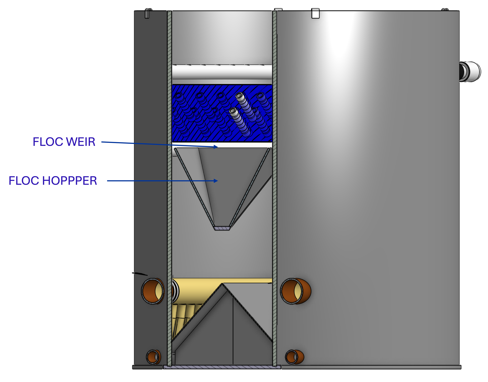

   Flocs enter the hopper by flowing over the floc weir. Sludge is drained from the bottom of the hopper.

Plate Settlers
--------------

After flowing through the floc filter, flocs reach the plate settlers. Plate settlers are sloped surfaces that provide additional settling area for flocs, thereby increasing the effective settling area of the clarifier without increasing the plan view area. AguaClara plate settlers are sloped at 50 degrees. The spacing between plates is 1.5 cm.

The plate settlers are made from clear polycarbonate sheets or stainless steel. The sheets are assembled in modules (see :numref:`figure_spec_PFplateSettlerModule`). The modules are light enough to be removed from the clarifier by hand. A PVC pipe frame attached to the clarifier walls supports the plate settler modules.

.. _figure_spec_PFplateSettlerModule:

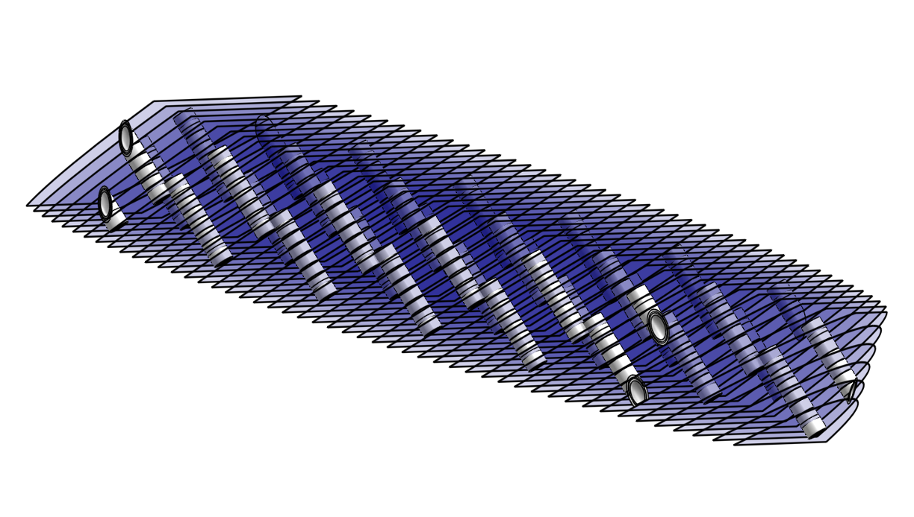

   Plate settler module assembled from sheets and piping.

.. _table_PF_Plate_Settler:

.. csv-table:: Plate Settler Design Parameters
   :header: Parameter, Determined by, Determines, Value
   :align: left

   Upflow velocity, Floc filter, Plan view area of tank, 1 mm/s maximum value
   Capture velocity, Target turbidity, Particle size distribution, 0.12 mm/s maximum value
   Plate angle, Self-cleaning requirement, Plate settler length, 50 degrees
   Plate spacing, Clogging and floc rollup constraints, Plate settler length, 1.5 cm
   Plate settler length, "Upflow velocity, Capture velocity, Plate angle, Plate spacing", Water depth, approximately 110 cm

Submerged Outlet Manifold
---------------------------

The submerged outlet manifold, sometimes called a launder, collects clarified water from the top of the clarifier. It is a horizontal pipe that extends along the length of the clarifier bay and is located above the plate settlers but below the surface of the water. The submerged pipe has orifices drilled into its top; water enters the pipe through the orifices and the pipe leads out of the clarifier bay.

The outlet manifold is designed to generate 1 cm of head loss to ensure uniform flow distribution between clarifier bays and to have the majority of the head loss through the orifices to obtain uniform flow distribution between the orifices. The outlet manifold leads into the outlet pipe that takes water from the clarifier to the filter.

Shallow Open Stacked Rapid Sand Filter
======================================

For more detailed information, see :ref:`Filtration Design <title_Filtration_Design>`. Stacked Rapid Sand (StaRS) filters were invented in 2010 by the AguaClara Cornell program in response to the need for a new technology that would both eliminate the need for backwash pumps and not require the construction of six filters for small towns. As shown in :numref:`figure_spec_PF_ShOStaRSfilterMode`, this filter is divided into four independent cells, each with two inlets, one outlet, and two 20 cm layers of sand. Clarified water enters the filter bed, passes through the sand, and is collected by a central slotted pipe. Accumulated sediment increases head loss over time, so operation requires regular filter backwashing.

.. _figure_spec_ShOStaRSoverview:

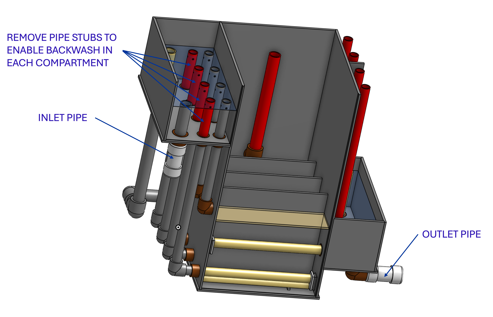

   The open stacked rapid sand filters include advanced hydraulic controls to ensure stable operation during both filtration and backwash modes.

Operation
---------

A. The filter operates at the same design flow rate in both filtration mode (see :numref:`figure_spec_PF_ShOStaRSfilterMode`) and backwash mode (see :numref:`figure_spec_PF_ShOStaRSbackwashMode`) and uses clarified water for backwash. This eliminates the need for backwash pumps and ensures that the filters can be backwashed as long as clarified water is available.

.. _figure_spec_PF_ShOStaRSfilterMode:

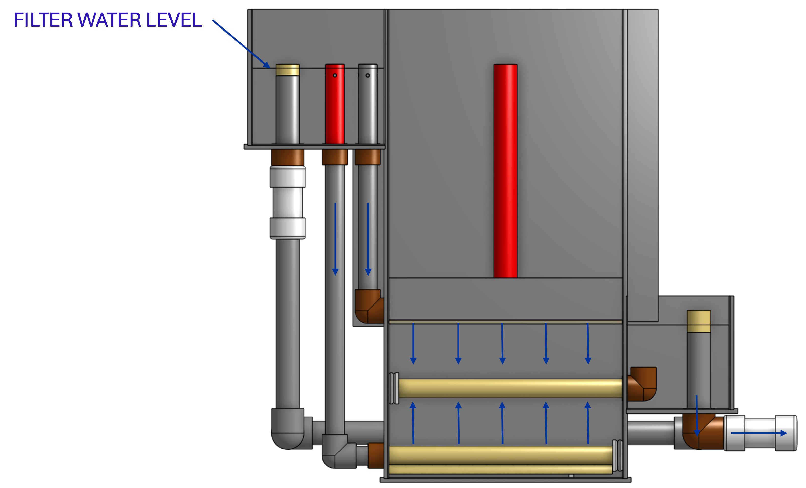

   In filtration mode, the flow divides equally between the eight inlets and the four compartments. The eight sand layers operate in parallel during filtration.

.. _figure_spec_PF_ShOStaRSbackwashMode:

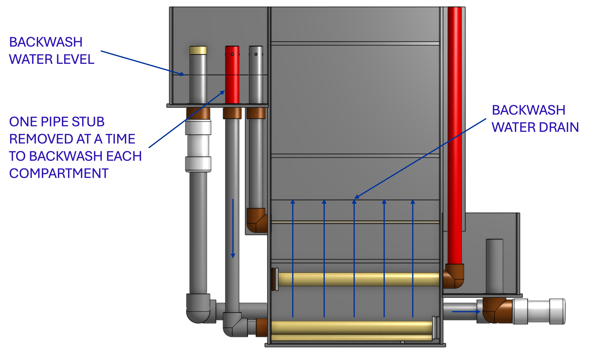

   In backwash mode, one pipe stub is removed at a time to backwash each of the four compartments. The water then exits through the backwash drain pipe.

Design Features
---------------

A. Stacked Rapid Sand (StaRS) filters were developed to eliminate the need for backwash pumps and minimize the plan area required.

#. The filters are designed to facilitate emptying the sand, removing and cleaning the modules, replacing the modules, and replacing the sand.

#. During backwash, the hydraulic controls isolate all outlets and all inlets except the bottommost inlet. All flow enters through the bottom inlet and exits through the backwash drain pipe.

Configuration
--------------

A. Shallow Open StaRS (ShOStaRS) with four filter compartments.

Sand Specification
------------------

ShOStaRS filters use two 20-cm-deep layers of silica sand (no dual media required), with the layers stacked vertically. The two layers give an active sand depth of 40 cm. The grain size is 0.45 to 0.55 mm.

Filter Modules
--------------

The sand layers are contiguous, and the only distinction between layers is the direction of flow during filtration. Each layer of sand sits between an inlet and outlet of the filter. The branch pipes are supported between the filter walls, with one end of the branch inserted into a pipe socket embedded in the wall and the other end supported by a pipe bracket. The inlet at the top of the filter does not require a branch pipe because the water enters the filter above the sand through the port.

A. Inlet Filter Branches

   1. Small holes (orifices) are drilled into the inlet branches (see :numref:`figure_spec_ShOStaRSinletManifold`). The orifice diameter is selected for constructability and to minimize the risk of clogging. The diameter is between 4 and 10 mm.

   #. During filtration mode, water flows out of the inlet branches through small holes, into the space created by the wing, and then into the sand.

   #. During the transition from backwash mode to filtration mode, a small volume of water may flow back into the inlet branches. The “wings,” PVC pipes cut longitudinally, are affixed to the inlet branches to prevent sand from flowing into the inlet pipe.

#. Outlet Filter Branches

   1. The 0.2 mm slots in the outlet branches (see :numref:`figure_spec_ShOStaRSoutletManifold`) prevent sand from passing through. The filter modules are supported to limit deflection of each module pipe to 2 mm or less, preventing significant opening or closing of the slots.

   #. During filtration mode, water flows from the filter media into the slots and through the pipe to the filter exit box.

   #. During backwash mode, the outlet branches are blocked.

.. _figure_spec_ShOStaRSinternalPiping:

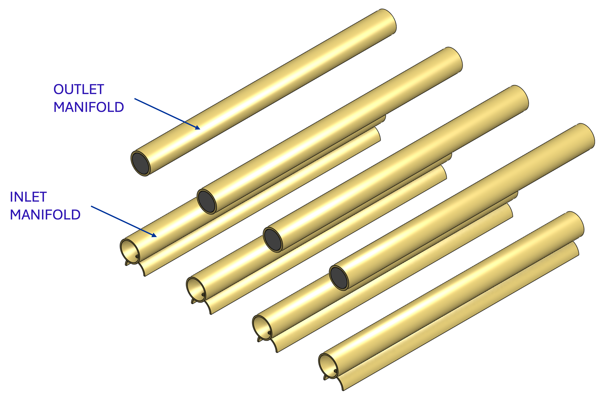

   The four filter cells are arranged side by side in the filter box. Each filter cell contains an inlet and outlet branch.

.. _figure_spec_ShOStaRSinletManifold:

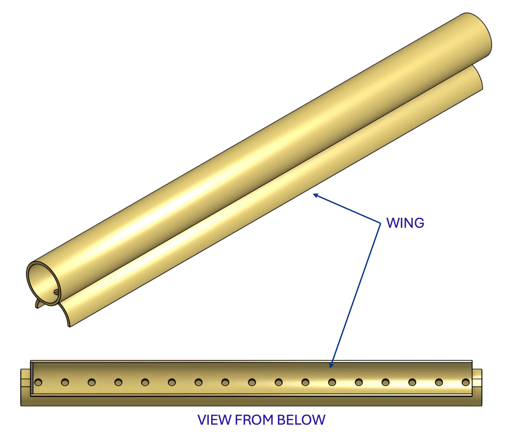

   The inlet branches use orifices to obtain uniform flow distribution and a wing system to prevent sand from entering the branches during backwash and filter-mode transitions.

.. _figure_spec_ShOStaRSoutletManifold:

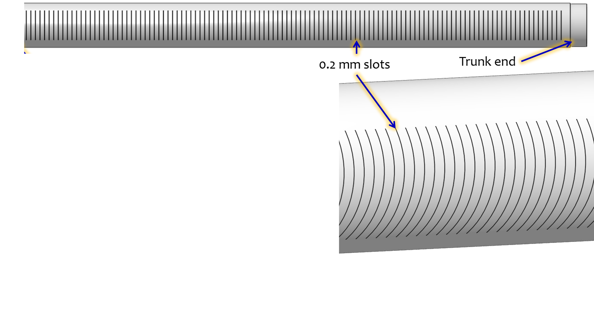

   The outlet branches use 0.2 mm slots to keep the sand in the filter bed.

Backwash Drain
--------------

The backwash drain pipe is designed to quickly lower the water level in the filter box to initiate backwash and to remove the dirty backwash water. The backwash drain pipe is connected to the filter box with a pipe stub that can be removed to allow the water to flow out of the filter box. The backwash drain pipe is designed to keep the water level in the filter box less than 5 cm above the top of the drain pipe entrance.

Sand Removal
-------------

Sand can be removed from the filter using a custom-made shovel that is narrow enough to fit between the cell divider and the branches. Activating backwash in the filter cell will fluidize the sand and allow it to be removed with the shovel.

Backwash Recycle
----------------

Backwash recycle is recommended for all communities where low flow conditions are likely to require water rationing. The backwash water storage tank is designed to hold the flow from one backwash event. A centrifugal pump can then be used to meter the water back to the entrance tank at a flow rate that empties the backwash water storage tank before the next filter needs to be backwashed.

In the event of a power failure, the backwash recycle system instead uses backwash to waste to dispose of the spent backwash water.

Disinfection
============

Sodium or calcium hypochlorite is metered into the filtered water as it exits the filter box and enters the pipe that carries the water to a chlorine contact tank or directly to the community distribution tank. The chlorine is added after the previous treatment processes to reduce the production of disinfection byproducts and to enable biofiltration. The chlorine concentration is set by adjusting the position of the slider on the doser (see :numref:`figure_spec_PF_doser`).
