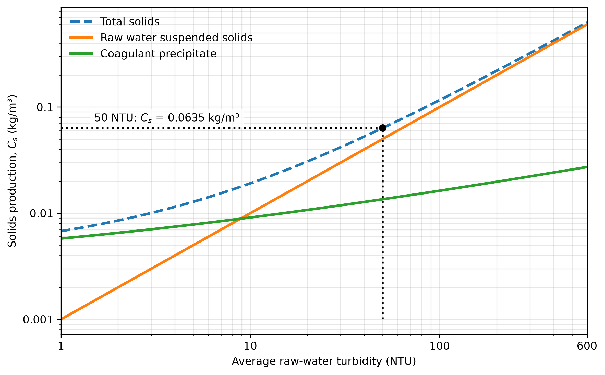
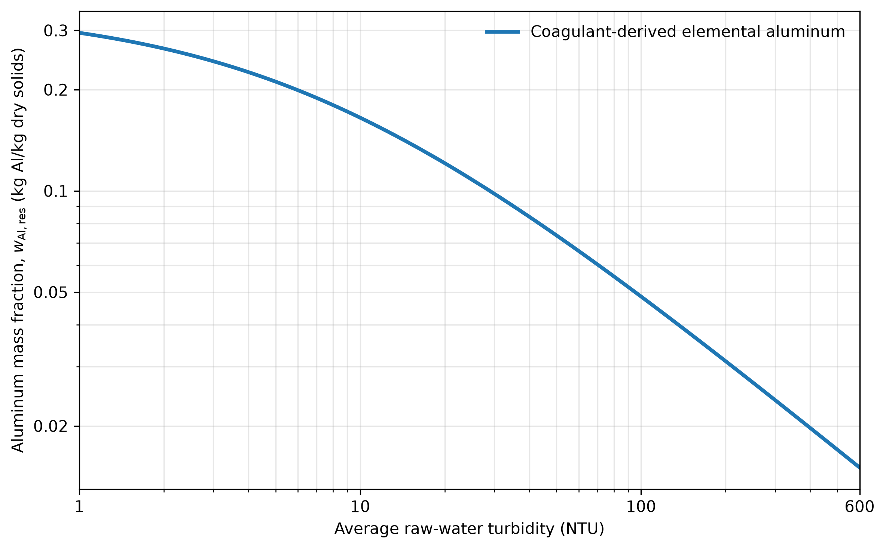

.. raw:: html

    <embed>
       
    </embed>

.. _title_residuals_generation_and_management:

***********************************
Residuals Generation and Management
***********************************

Drinking water treatment concentrates solids from the raw water into residual streams. Coagulant precipitation contributes additional solids. The solids contain particles including pathogens present in the raw water as well as dissolved organic matter that is adsorbed to the solids. The solids are removed from the treated water and discharged in residual streams. The two principal residual streams from an AguaClara plant are clarifier sludge purges and filter backwash. This chapter provides methods for estimating their solids loads, water volumes, and discharge characteristics for any plant capacity.

.. _heading_estimating_solids_production:

Estimating Solids Production
============================

Most solids removed by an AguaClara plant originate in the raw water. Aluminum coagulant also contributes solids as aluminum hydroxide. For a first estimate, the mass of solids generated per volume of raw water treated is

.. math::
   :label: residuals_total_solids_components

   C_s = k_T^C T_{\mathrm{in}} + Y_{\mathrm{Al}} D

where:

* :math:`C_s` is estimated solids production per volume of raw water treated, in kg/m³ (numerically equal to g/L);
* :math:`k_T^C` is the site-specific coefficient converting turbidity to suspended-solids concentration, in kg/(m³·NTU);
* :math:`T_{\mathrm{in}}` is the influent or raw-water turbidity, in NTU;
* :math:`Y_{\mathrm{Al}}` is the mass yield of aluminum hydroxide per mass of elemental aluminum dosed, dimensionless; and
* :math:`D` is the elemental-aluminum dose, in kg Al/m³.

For complete precipitation as :math:`\mathrm{Al(OH)_3}`, :math:`Y_{\mathrm{Al}}` is the ratio of the corresponding molar masses. The equation neglects dissolved constituents incorporated into the residuals and the small amount of solids leaving with treated water. The conversion factor :math:`k_T^C` is a function of the size distribution of the suspended solids.

- 0.68 mg/L per NTU: AguaClara's experimentally measured value for kaolin clay.
- 1.0 mg/L per NTU: Representative preliminary design value for river water.
- 0.7 – 2.0 mg/L per NTU: Suggested sensitivity range for preliminary calculations.

River water turbidity is often dominated by clay and silt particles, which are larger on average than kaolin clay. The larger particles have a smaller surface area per unit mass, which increases the mass per turbidity. The range of 0.7–2.0 mg/L per NTU is based on the observed range of turbidity per unit mass for different river waters. We will use :math:`k_T^C=0.001` kg/(m³·NTU) for preliminary calculations as this value should be within a factor of 2 and well within the range of uncertainty for residual management.

When the elemental-aluminum dose follows the AguaClara cube-root model,

.. math::
   :label: residuals_cube_root_coagulant_dose

   D = D_{\mathrm{DOM}} + k_T^D \sqrt[3]{T_{\mathrm{in}}}

where:

* :math:`D` is the elemental-aluminum dose, in kg Al/m³;
* :math:`D_{\mathrm{DOM}}` is the additive coagulant demand associated primarily with dissolved organic matter, in kg of Al/m³;
* :math:`k_T^D` is the source-specific coefficient converting cube-root turbidity to elemental-aluminum dose, in kg Al/(m³·NTU\ :sup:`1/3`); and
* :math:`T_{\mathrm{in}}` is the influent or raw-water turbidity, in NTU.

The elemental-aluminum dose is the product of the coagulant dose and the mass fraction of elemental aluminum in the coagulant product:

.. math::
   :label: residuals_elemental_aluminum_dose

    D = f_{\mathrm{Al}}C_{\mathrm{coag}}

where:

* :math:`C_{\mathrm{coag}}` is the coagulant-product dose, in kg/m³;
* :math:`f_{\mathrm{Al}}` is the mass fraction of elemental aluminum in the coagulant product, dimensionless; and
* :math:`D` is the Al dose, in kg of Al/m³.

.. math::
   :label: residuals_total_solids_turbidity

   C_s = k_T^C T_{\mathrm{in}} + Y_{\mathrm{Al}} \left(D_{\mathrm{DOM}}+k_T^D \sqrt[3]{T_{\mathrm{in}}}\right)

where:

* :math:`C_s` is estimated solids production per volume of raw water treated, in kg/m³;
* :math:`k_T^C` is the site-specific coefficient converting turbidity to suspended-solids concentration, in kg/(m³·NTU);
* :math:`T_{\mathrm{in}}` is raw-water turbidity, in NTU;
* :math:`Y_{\mathrm{Al}}` is the aluminum-hydroxide mass yield, dimensionless; and
* :math:`D_{\mathrm{DOM}}` and :math:`k_T^D` are the empirical dosing parameters defined above.

In the absence of site-specific data, use the following preliminary values for calculations:

* :math:`k_T^C=0.001` kg/(m³·NTU)
* :math:`Y_{\mathrm{Al}}=\frac{78}{27}` (for complete precipitation as :math:`\mathrm{Al(OH)_3}`)
* :math:`D_{\mathrm{DOM}}=0.001` kg/m³ (highly dependent on the source water)
* :math:`k_T^D=0.001 \frac{kg Al}{m^3·\sqrt[3]{NTU}}`

If daily turbidity data are available, use Equation :eq:`residuals_total_solids_turbidity` for every turbidity value to estimate the daily solids production. If only a single average estimated turbidity is available, use it to estimate the solids production for a typical day. When averaging the turbidity the resulting coagulant dose is not the same as the dose calculated from the average turbidity because of the cube-root relationship. Because coagulant dose increases with the cube root of turbidity, calculating the dose from average turbidity slightly overestimates average coagulant consumption. This overestimation has a negligible effect on the solids production estimate because the coagulant contribution is small compared to the solids from raw water. :numref:`figure_residuals_solids_production` illustrates the component and total solids-production estimates.

.. _figure_residuals_solids_production:

   Estimated solids production as a function of average raw-water turbidity. The suspended-solids and coagulant-precipitate contributions use the preliminary coefficients listed above; total solids production is the sum of the two contributions. The dotted construction lines show that an average turbidity of 50 NTU produces approximately 0.0635 kg/m³ of total solids.

For a plant treating :math:`V_d` cubic meters of raw water per day, the estimated dry-solids mass is

.. math::
   :label: residuals_daily_solids_mass

   M_s = V_d C_s

where:

* :math:`M_s` is the dry-solids mass generated per day, in kg/day;
* :math:`V_d` is the raw-water volume treated per day, in m³/day; and
* :math:`C_s` is estimated solids production per volume of raw water treated, in kg/m³.

For example, a 70 m³/day plant treating raw water with an average turbidity of 50 NTU generates approximately 4.4 kg of solids per day.

.. _heading_clarifier_sludge_purges:

Clarifier Sludge Purges
=======================

AguaClara clarifiers produce water with an average turbidity :math:`T_{\mathrm{clar}}` of approximately 0.5 NTU. The fraction of the solids production removed by the clarifier is

.. math::
   :label: residuals_clarifier_fraction_removed

   f_{\mathrm{clar}} = \frac{T_{\mathrm{in}} - T_{\mathrm{clar}}}{T_{\mathrm{in}}}

where:

* :math:`f_{\mathrm{clar}}` is the fraction of generated solids removed in the clarifier, dimensionless;
* :math:`T_{\mathrm{in}}` is the influent or raw-water turbidity, in NTU; and
* :math:`T_{\mathrm{clar}}` is the clarifier effluent turbidity, in NTU.

For the example above, raw water with a turbidity of 50 NTU produces a clarifier effluent of approximately 0.5 NTU, which corresponds to a clarifier capture fraction of 0.99.

The clarifier purges remove most of the captured solids except for the case of pristine rivers with very low turbidity. The clarifier purge concentration has not been systematically measured across AguaClara plants. A provisional range of **0.5–10 g/L TSS** may be used for preliminary estimates, **not** as a guaranteed operating range. Purge concentration is highly dependent on the raw water turbidity and dissolved organic matter concentrations. The clarifier purge concentration is expected to be significantly higher than the filter backwash concentration because the clarifier provides an opportunity for consolidation of the captured solids.

If a fraction :math:`f_{\mathrm{clar}}` of the total generated solids is removed in the clarifier, the daily purge volume is approximately

.. math::
   :label: residuals_daily_clarifier_purge_volume

   \forall_{\mathrm{clar}} = \frac{f_{\mathrm{clar}} M_s}{C_{\mathrm{clar}}}

where:

* :math:`\forall_{\mathrm{clar}}` is the daily clarifier-purge volume, in m³/day;
* :math:`f_{\mathrm{clar}}` is the fraction of generated solids removed in the clarifier, dimensionless;
* :math:`M_s` is the dry-solids mass generated per day, in kg/day; and
* :math:`C_{\mathrm{clar}}` is the purge total suspended solids concentration, in kg/m³.

For example, if :math:`M_s=4.4` kg/day, :math:`f_{\mathrm{clar}}=0.99`, and :math:`C_{\mathrm{clar}}=5` kg/m³, the estimated purge volume is :math:`\forall_{\mathrm{clar}}=0.87\ \mathrm{m^3/day}`.

Purge scheduling is being refined. Possible operating strategies include intermittent purges (for example, every 12 hours) for low raw water turbidities and a slow continuous purge. Sludge production and purge volume requirements increase with raw-water turbidity.

Combining Equations :eq:`residuals_daily_clarifier_purge_volume` and :eq:`residuals_daily_solids_mass` gives the daily clarifier purge volume as a function of solids concentration as given in :numref:`figure_residuals_solids_production`.

.. math::
   :label: residuals_daily_clarifier_purge_volume_of_solids_concentration

   \forall_{\mathrm{clar}} = \frac{f_{\mathrm{clar}} V_d C_s}{C_{\mathrm{clar}}}

where:

* :math:`\forall_{\mathrm{clar}}` is the daily clarifier-purge volume, in m³/day;
* :math:`f_{\mathrm{clar}}` is the fraction of generated solids removed in the clarifier, dimensionless;
* :math:`V_d` is the raw-water volume treated per day, in m³/day;
* :math:`C_s` is the solids production per volume of raw water treated, in kg/m³; and
* :math:`C_{\mathrm{clar}}` is the purge total suspended solids concentration, in kg/m³.

Equation :eq:`residuals_daily_clarifier_purge_volume_of_solids_concentration` can be used to estimate the clarifier purge volume for any plant capacity and raw-water turbidity. The purge volume is inversely proportional to the purge concentration, which is expected to vary with raw-water turbidity and dissolved organic matter concentration. The purge volume is directly proportional to the plant capacity and the solids production per unit volume of raw water treated. From :numref:`figure_residuals_solids_production`, the solids production per unit volume of raw water treated increases with raw-water turbidity.

.. _heading_filter_backwash:

Filter Backwash
===============

Filter backwash removes solids that pass through clarification and accumulate in the filter. Filtered-water turbidity, :math:`T_{\mathrm{fi}}`, is expected to be less than 0.1 NTU. For a clarifier effluent turbidity of 0.5 NTU, the filter therefore removes approximately 0.4 NTU.

For a filter whose backwash includes an initial discharge volume followed by discharge at approximately plant flow,

.. math::
   :label: residuals_backwash_event_volume

   \forall_b = \forall_0 + Q_p t_b

where:

* :math:`\forall_b` is the backwash volume per event, in m³;
* :math:`\forall_0` is the initial discharge volume, in m³;
* :math:`Q_p` is the plant flow rate during the subsequent discharge, in m³/s; and
* :math:`t_b` is the total backwash duration starting from the initial discharge, in s.

If backwashing occurs every :math:`t_i` seconds of operation, the backwash water fraction is

.. math::
   :label: residuals_backwash_water_fraction

   F_b = \frac{\forall_b}{Q_p t_i}

where:

* :math:`F_b` is the fraction of treated water used for backwashing, dimensionless;
* :math:`\forall_b` is the backwash volume per event, in m³;
* :math:`Q_p` is the plant flow rate, in m³/s; and
* :math:`t_i` is the time between the start of backwash events, in s.

The average daily backwash volume is

.. math::
   :label: residuals_daily_backwash_volume

   \forall_{b,d} = F_b Q_p t_d

where:

* :math:`\forall_{b,d}` is the average daily backwash volume, in m³/day;
* :math:`F_b` is the fraction of treated water used for backwashing, dimensionless;
* :math:`Q_p` is the plant flow rate, in m³/s; and
* :math:`t_d` is the number of operating seconds per day.

**PF70 example.** The ShOStaRS filter is expected to require a backwash every 12–30 hours of operation, depending on raw-water turbidity, coagulant dose, and clarifier performance. The backwash duration is expected to be approximately 15–20 minutes. For this example, use a plant flow of :math:`Q_p=70\ \mathrm{m^3/day}`, an initial discharge volume of :math:`\forall_0=0.200\ \mathrm{m^3}`, a backwash duration of :math:`t_b=15\ \mathrm{min}`, and an interval of :math:`t_i=18\ \mathrm{h}`.

Substitution into Equation :eq:`residuals_backwash_event_volume` gives the backwash volume per event:

.. math::
   :label: residuals_pf70_backwash_event_volume

   \forall_b
   = 0.200\ \mathrm{m^3}
   + \left(70\ \frac{\mathrm{m^3}}{\mathrm{day}}\right)
     \left(15\ \mathrm{min}\right)
     \left(\frac{1\ \mathrm{day}}{1440\ \mathrm{min}}\right)
   = 0.929\ \frac{\mathrm{m^3}}{\mathrm{event}}

Using Equation :eq:`residuals_backwash_water_fraction`, the fraction of treated water used for backwashing is

.. math::
   :label: residuals_pf70_backwash_water_fraction

   F_b
   = \frac{0.929\ \mathrm{m^3/event}}
     {\left(70\ \mathrm{m^3/day}\right)
      \left(18\ \mathrm{h/event}\right)
      \left(1\ \mathrm{day}/24\ \mathrm{h}\right)}
   = 0.0177
   = 1.77\%

Equation :eq:`residuals_daily_backwash_volume` then gives the average daily backwash volume:

.. math::
   :label: residuals_pf70_daily_backwash_volume

   \forall_{b,d}
   = F_b Q_p t_d
   = \left(0.0177\right)
     \left(70\ \frac{\mathrm{m^3}}{\mathrm{day}}\right)
   = 1.24\ \frac{\mathrm{m^3}}{\mathrm{day}}

Preliminary estimates of backwash-water quality are **10–50 NTU** and **10–50 mg/L TSS**. If the clarifier effluent turbidity is :math:`T_{\mathrm{clar}}=0.5\ \mathrm{NTU}` and the filter effluent turbidity is :math:`T_{\mathrm{fi}}=0.1\ \mathrm{NTU}`, the filter removes a turbidity equivalent of :math:`0.4\ \mathrm{NTU}`. Assuming this captured-solids concentration is conserved and released in the backwash fraction, the estimated backwash turbidity is

.. math::
   :label: residuals_pf70_backwash_turbidity

   T_b
   \approx \frac{T_{\mathrm{clar}}-T_{\mathrm{fi}}}{F_b}
   = \frac{0.5\ \mathrm{NTU}-0.1\ \mathrm{NTU}}{0.0177}
   = 22.6\ \mathrm{NTU}

where :math:`T_b` is the estimated backwash turbidity. This estimate falls within the preliminary range above.

The formulas assume stable plant flow and a representative backwash interval. The actual event discharge hydrograph is needed to size conveyance or equalization facilities.

At an assumed backwash concentration :math:`C_b` (kg/m³), the solids discharged per event are

.. math::
   :label: residuals_backwash_solids_mass

   M_b = \forall_b C_b

where:

* :math:`M_b` is the solids discharged per backwash event, in kg/event;
* :math:`\forall_b` is the backwash volume per event, in m³/event; and
* :math:`C_b` is the flow-weighted backwash solids concentration, in kg/m³.

The actual solids concentration changes during a backwash, so a flow-weighted composite sample is preferable to a single grab sample.

.. _heading_discharge_characteristics_and_management:

Discharge Characteristics and Management
========================================

.. _heading_aluminum_in_residual_solids:

Aluminum in Residual Solids
---------------------------

Aluminum coagulant contributes aluminum hydroxide to both residual streams. Assuming that all dosed elemental aluminum precipitates and remains in the residual solids, the coagulant-derived elemental-aluminum mass fraction is the elemental-aluminum dose divided by the total dry-solids production. Substituting Equation :eq:`residuals_cube_root_coagulant_dose` and Equation :eq:`residuals_total_solids_turbidity` gives

.. math::
   :label: residuals_aluminum_mass_fraction

   w_{\mathrm{Al,res}}
   = \frac{D}{C_s}
   = \frac{D_{\mathrm{DOM}}+k_T^D\sqrt[3]{T_{\mathrm{in}}}}
   {k_T^C T_{\mathrm{in}}
   +Y_{\mathrm{Al}}\left(D_{\mathrm{DOM}}+k_T^D\sqrt[3]{T_{\mathrm{in}}}\right)}

where:

* :math:`w_{\mathrm{Al,res}}` is the coagulant-derived elemental-aluminum mass fraction of the dry residual solids, in kg Al/kg dry solids;
* :math:`D` is the elemental-aluminum dose, in kg Al/m³;
* :math:`C_s` is the total dry-solids production per volume of raw water treated, in kg/m³;
* :math:`D_{\mathrm{DOM}}` is the additive elemental-aluminum demand associated primarily with dissolved organic matter, in kg Al/m³;
* :math:`k_T^D` is the site-specific turbidity-to-dose coefficient, in kg Al/(m³·NTU\ :sup:`1/3`);
* :math:`T_{\mathrm{in}}` is the influent raw-water turbidity, in NTU;
* :math:`k_T^C` is the site-specific suspended-solids-concentration-to-turbidity coefficient, in kg/(m³·NTU); and
* :math:`Y_{\mathrm{Al}}` is the aluminum-hydroxide mass yield per mass of elemental aluminum dosed, dimensionless.

Equation :eq:`residuals_aluminum_mass_fraction` estimates aluminum added by the coagulant, not aluminum naturally present in clay, silt, or other source-water solids. It also excludes dissolved aluminum that does not precipitate. The corresponding aluminum-hydroxide mass fraction is :math:`Y_{\mathrm{Al}}w_{\mathrm{Al,res}}`. Site-specific residuals characterization should be used when total aluminum concentration or disposal suitability must be established. The estimate applies to both clarifier purges and filter backwash.

.. _figure_residuals_aluminum_mass_fraction:

   Coagulant-derived elemental-aluminum mass fraction of the dry residual solids as a function of average raw-water turbidity. The curve uses Equation :eq:`residuals_aluminum_mass_fraction` and the preliminary coefficients listed in the solids-production section. This graph is based on the assumed dosing model and preliminary coefficients. Actual aluminum mass fraction may vary significantly with source water characteristics, coagulant product, and operating conditions.

.. _heading_other_discharge_characteristics:

Other Discharge Characteristics
-------------------------------

* **pH:** The pH of both streams is expected to be near raw-water pH, but coagulant chemistry and operating conditions can cause differences. Verify when pH is relevant to disposal approval.
* **Other treatment chemicals:** AguaClara uses an aluminum coagulant (such as polyaluminum chloride or aluminum sulfate); no separate polymer flocculant is normally added. The coagulant contributes aluminum hydroxide solids. Chlorine is generally dosed after filtration and is not normally a major constituent of clarifier purges or filter backwash.
* **Hydraulics:** For the PF70 configuration described here, discharge pipe outlets are near the plant floor. Actual outlet elevations, pipe sizes, and discharge connections must be documented for each plant.
* **Management options:** Depending on local requirements, residuals may be settled or thickened before further handling, with clarified supernatant managed separately. Reuse, irrigation, wetland treatment, or discharge to a receiving water requires site-specific evaluation and regulatory approval.
